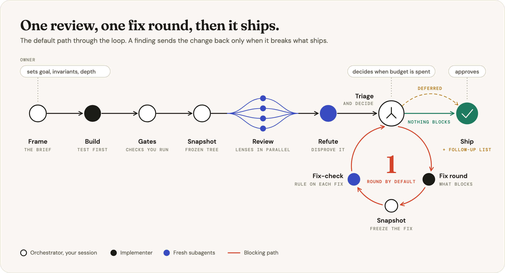
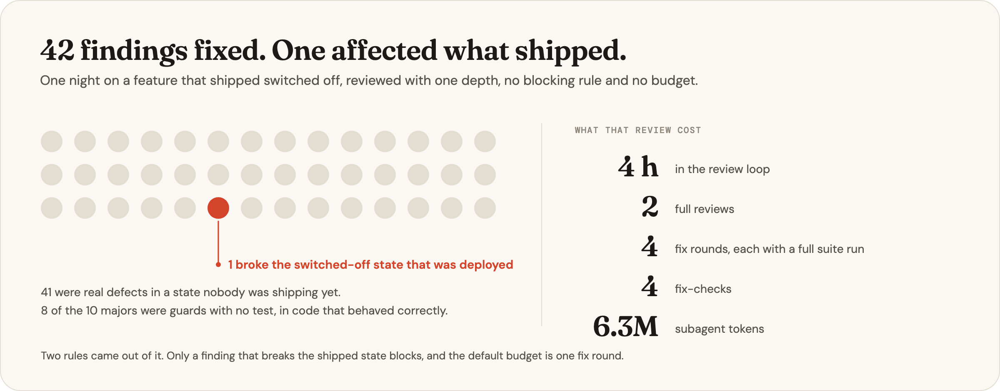
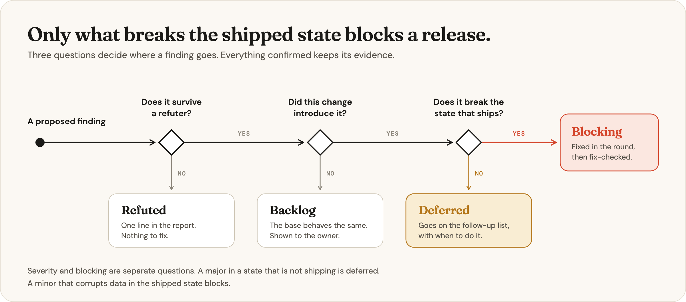
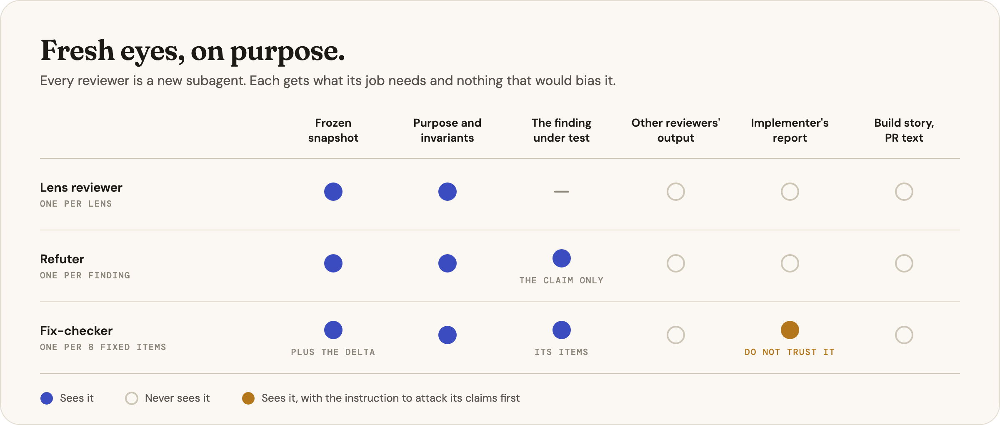

# agentic-review

A skill for Claude Code that reviews a change until it is ready to ship, and stops there.

<picture>
  <source media="(prefers-color-scheme: dark)" srcset="docs/img/loop-dark.webp">
  
</picture>

You built a change, or an agent built it for you. This skill runs the review. Fresh subagents read a frozen snapshot of the change, each through one lens. A second set of subagents tries to disprove what they found.

Every confirmed finding is then sorted by one question: does it break what you are about to ship? The implementer fixes the ones that do, and a fix-check rules on each fix. The rest goes on a follow-up list with its evidence.

The depth of the review is chosen up front and scales with the change. The default budget is one fix round and one fix-check. Nothing merges, pushes or deploys without your approval.

## Contents

- [Why it exists](#why-it-exists)
- [How the loop runs](#how-the-loop-runs)
- [Depth](#depth)
- [What blocks a release](#what-blocks-a-release)
- [Independent reviewers](#independent-reviewers)
- [The rules that pick the next step](#the-rules-that-pick-the-next-step)
- [What you get](#what-you-get)
- [Install](#install)
- [Use](#use)
- [Cost](#cost)
- [Evidence and limits](#evidence-and-limits)
- [Repository layout](#repository-layout)

## Why it exists

Two measurements shaped the loop.

**Fixing is where new defects come from.** Over four days on one project, with 17 full reviews and 18 checked fix rounds, 95% of targeted findings were fixed. In that same data, 83% of fix rounds introduced at least one new defect. A fix is new code, so it gets checked by reviewers who did not write it.

**Review has a cost that grows with every round.** A later run reviewed a feature that shipped switched off. It took four hours, and 42 findings were fixed. One of them affected the state that was deployed.

<picture>
  <source media="(prefers-color-scheme: dark)" srcset="docs/img/one-in-42-dark.webp">
  
</picture>

The other 41 were real defects in a state nobody was shipping yet. They belonged on a list for the day the feature was switched on. The loop now sizes the review before it starts and separates what blocks the release from what can wait.

## How the loop runs

Your Claude Code session is the orchestrator. It writes every prompt, runs the checks itself, and keeps the state on disk. It never edits product code.

| Step | Who | What happens |
|---|---|---|
| Frame | You and the orchestrator | A short brief: what the change does, three to six concrete invariants, the depth, the state that ships and the round budget |
| Build | Implementer | Codex, a subagent in its own worktree, or you. Skipped when the change already exists |
| Gates | Orchestrator | Runs the checks that cover the change. The implementer's green is never taken on trust |
| Snapshot | Orchestrator | Freezes the tree and the patch. Reviewers never read the live checkout |
| Review | Fresh subagents | One per lens, in parallel: correctness, failure handling, safety and security, tests and design |
| Refute | Fresh subagents | One per finding that needs it. Each tries to disprove one claim from the code |
| Triage | Orchestrator | Marks each confirmed finding blocking or deferred, and tells you right away |
| Fix round | Implementer | Fixes the blocking items, each with a test that fails before the fix and passes after |
| Fix-check | Fresh subagents | Rule on each fix and hunt for regressions the fix introduced |
| Ship | You | Approve the merge, push or deploy. You get the follow-up list with the release |

## Depth

A four-line change and a data migration should not get the same review. The depth is picked when the piece is framed and written into the brief.

<picture>
  <source media="(prefers-color-scheme: dark)" srcset="docs/img/depth-dark.webp">
  
</picture>

Start from the lightest depth that fits. Go up one level for each of these: the change touches authorization, delivery, stored data or money, it runs unattended, or it is over about 600 changed lines of source. A feature that ships switched off is reviewed for the switched-off state, which usually means one level lower.

You can ask for a deeper review at any point. The skill never goes deeper without asking.

## What blocks a release

Severity and blocking are separate questions. A finding blocks when it breaks an invariant in the state that ships, when shipping it would do damage that can't be undone, or when it is a check failure the change introduced.

<picture>
  <source media="(prefers-color-scheme: dark)" srcset="docs/img/triage-dark.webp">
  
</picture>

A few rules keep the fix round small:

- **Deferred findings keep their evidence.** Each gets one line on the follow-up list, with what it affects and when it should be done, such as "before the switch is turned on".
- **Missing-test findings are capped at five.** A tests lens that removes guards one at a time can report every survivor. It is asked for the five that guard an invariant in the state that ships.
- **A fix that needs a new mechanism is a new piece.** A new check with its own rules, a new stored field, a new authorization path: the round stops and the mechanism gets its own review. In one run, a guard designed inside a fix round produced two of the next review's major findings.
- **No second full review by default.** It happens when you ask for one, or when the change now contains a merge with the base.

## Independent reviewers

Several review passes are worth more than one only when they are independent. In one study, telling a reviewer that a change was safe cut vulnerability detection by 16 to 93 points.

<picture>
  <source media="(prefers-color-scheme: dark)" srcset="docs/img/independence-dark.webp">
  
</picture>

- **Fresh subagents only.** Each reviewer, refuter and fix-checker is a new agent. None inherits the session's conversation, and none is reused for a later round.
- **No build story.** Reviewers get the snapshot, a one-paragraph purpose, the invariants and the known issues. They never get the PR description, the commit messages or the orchestrator's opinion.
- **A refuter gets the claim without the argument.** It traces the code path itself. To refute a blocker or major it has to run something and quote the output.
- **Read-only on the code and the machine.** Each agent runs probes in its own cloned copy, kills only processes it started, and removes only paths it created. The bundled scripts enforce this.

## The rules that pick the next step

After a fix-check, the first rule that matches decides what happens. The rule and the numbers behind it go into the log.

| # | Signal | Next step |
|---|---|---|
| R1 | You report a problem, or a live incident happens, while a round is open | Fold it into the round |
| R2 | A regression mirrors the finding just fixed, or one mechanism regressed twice in a row | Stop patching. Write both failure modes as tests and have the owner decide the trade-off |
| R3 | A fix needs a new mechanism, or a fix round added one | Stop the round. The mechanism becomes its own piece with its own review |
| R4 | Nothing blocks and the gates pass | Ship, with the follow-up list |
| R5 | Something still blocks and the budget has rounds left | One fix round with the checker's evidence, then a fix-check |
| R6 | Something still blocks and the budget is spent | Stop and report. You pick: one more round, ship switched off, or re-plan |
| R7 | The implementer rejected an item | The fix-check judges the rejection |
| R8 | Two rounds would edit the same files | Queue the second |
| R9 | Usage is at your reserve threshold | Take the snapshot now and run the review after the window resets |

## What you get

The loop's state lives in files, so a review that runs for days survives a restart or a compacted conversation.

```
<piece>-review/
├── brief.md          purpose, invariants, depth, the state that ships, round budget
├── ledger.json       every finding: severity, blocking, verdicts, status, history
├── log.md            one line per decision, with the rule that fired
├── RESUME.md         what is running now and how to resume it
├── s1/ s2/ …         one frozen snapshot per review and per fix-check
├── prompts/          every prompt sent
└── reports/          every report received
```

After triage, and whenever you need to decide something, you get a short report: a verdict line with the rule that fired, the blocking items with their evidence, the follow-up list, the decisions waiting on you, and the totals so far.

## Install

As a Claude Code plugin:

```sh
claude plugin marketplace add hcastro/agentic-review
claude plugin install agentic-review@agentic-review
```

To update it later:

```sh
claude plugin marketplace update agentic-review
claude plugin update agentic-review@agentic-review
```

As a plain skill, copy the folder into your skills directory:

```sh
git clone https://github.com/hcastro/agentic-review
cp -R agentic-review/skills/agentic-review ~/.claude/skills/
```

A copied skill does not update itself. Compare it with this repository before a long review.

**Requirements:** `git`, an agent that can launch subagents (Claude Code's Agent tool), and an implementer: Codex CLI, a subagent in its own git worktree, or you. The repository's own checks must be runnable from the session.

## Use

Ask for a review of a change you own:

```
Run the review loop on this branch.
```

```
Light review of my change before I commit.
```

```
Codex finished the archiver piece. Review it until it is ready to merge.
```

The skill frames the piece first and confirms the brief with you, unless you have told it to carry on without stopping.

Your own rules win. When your instructions set a depth, a round budget, a worktree location, a usage policy, approval rules or a writing style, the skill follows them.

It is built for changes you own and intend to fix. For a teammate's pull request, or a review with no fixes, use a different tool.

## Cost

Measured in subagent tokens, from the runs in [evidence.md](skills/agentic-review/references/evidence.md):

| Depth | Agents' time | Subagent tokens |
|---|---|---|
| Light | a few minutes | about 0.3M |
| Standard | about 10 minutes | about 1M |
| Full | 20 to 30 minutes | about 2M, plus about 0.5M per fix-check |

The implementer's fix round usually takes longer than the review, and it reruns checks and brings its own regressions. That is the reason one round is the default.

The skill caps itself at about eight concurrent agents and runs one full review at a time. With 16 to 20 agents on one machine, over 100 test runs timed out from load alone.

## Evidence and limits

Every rule in the skill points at a measurement. They come from three runs of the loop and from published studies, and all of them are written up in [evidence.md](skills/agentic-review/references/evidence.md). The sample sizes are small, so treat the thresholds as starting points.

| Finding | Where it shows up in the loop |
|---|---|
| 83% of fix rounds introduced at least one regression | Every fix round is followed by a fix-check |
| Refuters that only read the code refuted 26% of findings. Refuters that ran code refuted 7% | Refuting a blocker or major requires an executed check |
| Defects found by several lenses were major or worse 68% of the time, against 25% for a single lens | Lens agreement feeds triage |
| Confirmed findings per review stayed between 7 and 19 across a 39-fold range of change size | Large changes are split before review |
| 42 findings fixed, 1 affected the shipped state | The blocking rule and the round budget |

The loop also misses things. Four defects reached the owner within about 36 hours of reviewed code merging: an operating-system privacy rule on the deployed machine, a missing request timeout that two reviews did not raise, a UI that matched the brief and missed the approved prototype, and a test run that broke a shared live directory. Operating-system permissions, network rules and real devices are invisible to a read of the tree. For an unattended service, add a deployed smoke test as its own check.

## Repository layout

```
skills/agentic-review/
├── SKILL.md              the loop, the roles and the decision rules
├── references/
│   ├── prompts.md        templates for the brief, lenses, refuter, fix and fix-check
│   ├── ledger.md         the ledger schema and statuses
│   └── evidence.md       the measurements behind each rule
└── scripts/
    ├── snapshot.sh       freeze a checkout without touching it
    ├── scratch.sh        give one agent a cloned, runnable copy
    ├── mutate.sh         break lines one at a time and report what the tests catch
    ├── fakebin.sh        fake clipboard tools for probes
    ├── fake-tool.sh      a fake git or delta that records the processes it starts
    └── kill-recorded.sh  kill only those recorded processes
docs/
├── diagrams/             the figures' source and the script that renders them
└── img/                  the rendered figures, light and dark
```

To re-render the figures after editing `docs/diagrams/diagrams.html`:

```sh
NODE_PATH="$(npm root -g)" node docs/diagrams/render.cjs
```

## License

MIT
